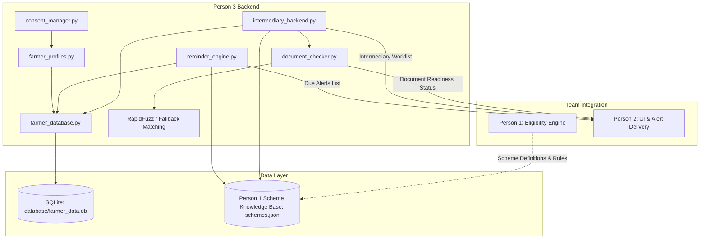

# Farmer Assistance System – Person 3 Backend Documentation

## Overview

As **Person 3** in the 3-member hackathon team, this backend package provides the foundational data and calculation layer for the **Farmer Assistance System**:

1. **Farmer Profile Management**: SQLite-based persistence for farmer information.
2. **Consent Lifecycle Management**: Mandatory opt-in, clear purpose specification, and instant revocation.
3. **Smart Reminder Engine**: Prioritised notifications with special precedence for crop insurance claim windows.
4. **Document Readiness Checker**: Verifies document prerequisites without confusing paperwork with statutory eligibility.
5. **Name Mismatch Detection**: Fuzzy name comparison between farmer profiles and bank accounts using RapidFuzz (with fallback).
6. **CSC/FPO Intermediary Mode**: Actionable, prioritized queue for village-level entrepreneurs and farmer producer organizations.
7. **Comprehensive Automated Testing**: 12/12 unit and integration test scenarios passing.

---

## Architecture Flow



---

## Directory Structure

```text
VOSC/
├── person3/
│   ├── __init__.py               # Package exports
│   ├── farmer_database.py        # SQLite connection and automatic schema setup
│   ├── farmer_profiles.py        # Profile CRUD, validation, and search
│   ├── consent_manager.py        # Consent enforcement and withdrawal
│   ├── reminder_engine.py        # Smart reminder calculation and claim-window priority
│   ├── document_checker.py       # Document readiness & name mismatch detection
│   ├── intermediary_backend.py   # CSC/FPO staff assistant dashboard backend
│   ├── test_person3.py           # 12 automated test scenarios
│   ├── README.md                 # Full documentation
│   └── requirements.txt          # Dependencies (rapidfuzz)
├── database/
│   └── farmer_data.db            # Auto-generated SQLite database
├── data/
│   └── schemes.json              # Person 1's scheme definitions & deadlines
├── person3_backend.py            # Standalone runnable demo & integration hub
└── requirements.txt              # Root dependencies
```

---

## Database Structure

The SQLite database is initialized automatically at `database/farmer_data.db`.

### Schema: `farmers`

| Column | Type | Constraints | Description |
|---|---|---|---|
| `farmer_id` | TEXT | PRIMARY KEY | Unique identifier (e.g., `F101`, `DEMO_F001`) |
| `farmer_name` | TEXT | NOT NULL | Farmer's full name |
| `phone_number` | TEXT | NULLABLE | Contact telephone |
| `preferred_language` | TEXT | DEFAULT 'te' | Preferred language (`Telugu`, `Hindi`, `English` or `te`, `hi`, `en`) |
| `intermediary_id` | TEXT | NULLABLE | CSC / FPO facilitator ID (e.g., `CSC_WARANGAL_01`) |
| `consent_status` | INTEGER | CHECK (0, 1) | `1` = Active Consent, `0` = Withdrawn |
| `uploaded_documents` | TEXT | NOT NULL | JSON string storing document availability flags |
| `bank_account_name` | TEXT | NULLABLE | Name as registered with the bank |
| `created_at` | TEXT | NOT NULL | ISO 8601 registration timestamp |

### Indexes
- `idx_farmers_intermediary`: Fast filtering on `intermediary_id` for CSC/FPO dashboards.
- `idx_farmers_consent`: Fast filtering on `consent_status` to exclude opted-out farmers.

### Privacy Policy in Code
- **No Aadhaar Numbers Stored**: The database never stores 12-digit Aadhaar numbers or scanned documents.
- **Document Flags Only**: Documents are recorded as boolean readiness markers (e.g., `{"Aadhaar": true, "Bank Passbook": false}`).
- **Purpose Limitation**: Data is used strictly for scheme verification and reminders.

---

## Core Functions & Examples

### 1. Database Initialization
```python
from person3 import init_db

db_path = init_db()
# Creates database/farmer_data.db and indices if not present
```

---

### 2. Farmer Registration & Profile Retrieval

#### `save_profile(profile)`
Registers a new farmer. Validates required fields and explicit consent. Prevents duplicate farmer IDs.

**Input:**
```python
profile = {
    "farmer_id": "F_2026_001",
    "farmer_name": "Ravi Kumar",
    "phone_number": "9876543210",
    "preferred_language": "Telugu",
    "intermediary_id": "CSC_01",
    "consent_status": True,
    "uploaded_documents": {
        "Aadhaar": True,
        "Bank Passbook": True,
        "Land Records": True
    },
    "bank_account_name": "Ravi Kumar"
}
saved = save_profile(profile)
```

**Output:**
```json
{
  "farmer_id": "F_2026_001",
  "farmer_name": "Ravi Kumar",
  "name": "Ravi Kumar",
  "phone_number": "9876543210",
  "preferred_language": "Telugu",
  "intermediary_id": "CSC_01",
  "consent_status": true,
  "uploaded_documents": {"Aadhaar": true, "Bank Passbook": true, "Land Records": true},
  "bank_account_name": "Ravi Kumar",
  "created_at": "2026-11-05T12:00:00"
}
```

#### `get_profile(farmer_id)` / `search_farmer(farmer_id)`
```python
profile = get_profile("F_2026_001")
```

#### `update_profile(farmer_id, updated_data)`
```python
updated = update_profile("F_2026_001", {
    "phone_number": "9876500000",
    "uploaded_documents": {"Aadhaar": True, "Bank Passbook": True, "Land Records": True, "Sowing Certificate": True}
})
```

---

### 3. Consent Management

#### `withdraw_consent(farmer_id)`
Immediately revokes consent. The farmer will be excluded from all reminder alerts and intermediary lists.
```python
from person3 import withdraw_consent, is_consent_active

withdraw_consent("F_2026_001")
print(is_consent_active("F_2026_001"))  # False
```

---

### 4. Name Mismatch Detection (Task 5)

#### `check_name_match(farmer_name, bank_account_name)`
Uses RapidFuzz (with fallback to exact string normalization) to detect minor typos or severe discrepancies without making accusations of fraud.

**Input:**
```python
from person3 import check_name_match

res = check_name_match("Ravi Kumar", "Ravi Kumer")
```

**Output:**
```json
{
  "match_status": "possible_mismatch",
  "similarity_score": 90.0,
  "requires_manual_verification": true,
  "warning_message": "Minor spelling variation detected between farmer name ('Ravi Kumar') and bank name ('Ravi Kumer') with similarity 90.0%. Manual verification recommended.",
  "method_used": "rapidfuzz"
}
```

---

### 5. Document Readiness Checker (Task 4)

#### `check_documents(profile, scheme)`
Verifies whether prerequisite paperwork is collected.

**Input:**
```python
from person3 import check_documents

scheme = {
    "name": "PM-KISAN Samman Nidhi",
    "documents_required": ["Aadhaar", "Bank Passbook", "Land Records"],
    "name_match_required": True
}
profile = {
    "farmer_name": "Ravi Kumar",
    "bank_account_name": "Ravi Kumar",
    "uploaded_documents": {"Aadhaar": True, "Land Records": True}
}

status = check_documents(profile, scheme)
```

**Output:**
```json
{
  "ready": false,
  "missing": ["Bank Passbook"],
  "mismatches": []
}
```

---

### 6. Smart Reminder Engine (Task 3)

#### `get_due_alerts(today, scheme_data, days_before=7)`
Identifies approaching deadlines. Prioritizes crop insurance claim windows (Priority 1) over regular scheme deadlines (Priority 2). Excludes expired deadlines and farmers who withdrew consent.

**Input:**
```python
from person3 import get_due_alerts
from datetime import date

alerts = get_due_alerts("2026-11-05", scheme_data, days_before=7)
```

**Output:**
```json
[
  {
    "farmer_id": "F_2026_001",
    "farmer_name": "Ravi Kumar",
    "preferred_language": "Telugu",
    "scheme": "Pradhan Mantri Fasal Bima Yojana (PMFBY)",
    "days_left": 5,
    "message_key": "claim_window_closing",
    "due_date": "2026-11-10",
    "event_type": "insurance_claim_window",
    "priority": 1
  }
]
```

---

### 7. Intermediary Backend (Task 6)

#### `get_intermediary_farmers(scheme_data, today, intermediary_id=None)`
Returns an operational task queue for CSC / FPO center operators.

**Input:**
```python
from person3 import get_intermediary_farmers

queue = get_intermediary_farmers(scheme_data, today="2026-11-05", intermediary_id="CSC_01")
```

**Output:**
```json
[
  {
    "farmer_id": "F_2026_001",
    "farmer_name": "Ravi Kumar",
    "intermediary_id": "CSC_01",
    "scheme": "Pradhan Mantri Fasal Bima Yojana (PMFBY)",
    "missing_documents": ["Bank Passbook", "Sowing Certificate"],
    "mismatches": [
      {
        "field": "farmer_name_vs_bank_name",
        "match_status": "possible_mismatch",
        "similarity_score": 90.0,
        "requires_manual_verification": true
      }
    ],
    "name_mismatch_warning": "Minor spelling variation detected...",
    "upcoming_claim_deadlines": "2026-11-10",
    "scheme_deadline": "2026-11-20",
    "remaining_days": 5,
    "priority_rank": 1,
    "priority_label": "CRITICAL: Insurance Claim Window Closing",
    "requires_assistance": true
  }
]
```

---

## Integration Contracts with Team Members

### Contract with Person 1 (Scheme Knowledge & Eligibility Engine)
- Person 1 provides `data/schemes.json` containing:
  - `name`: Scheme Title
  - `deadline`: Scheme submission deadline (`YYYY-MM-DD`)
  - `claim_window`: `{"start": "...", "end": "..."}` for crop insurance
  - `documents_required`: List of required document strings
  - `name_match_required`: Boolean
- Person 1 provides `check_eligibility(profile)` for statutory eligibility evaluation. Person 3 never overrides or duplicates eligibility logic.

### Contract with Person 2 (Frontend & Delivery System)
Person 2 imports Person 3's backend directly:
```python
from person3 import (
    save_profile,
    get_profile,
    update_profile,
    withdraw_consent,
    check_documents,
    check_name_match,
    get_due_alerts,
    get_intermediary_farmers
)
```
- **Alert Dispatch**: Person 2 polls `get_due_alerts(today)` and dispatches SMS/WhatsApp notifications in the farmer's `preferred_language`.
- **Intermediary Dashboard**: Person 2 calls `get_intermediary_farmers(intermediary_id=user_id)` to render tables with missing documents, mismatch alerts, and urgent deadlines.

---

## Running the Code

### 1. Install Dependencies
```powershell
pip install -r requirements.txt
```

### 2. Run the Interactive Demo
```powershell
python person3_backend.py
```

### 3. Run Automated Tests
```powershell
python person3/test_person3.py
```
Or with unittest discover:
```powershell
python -m unittest discover -s person3 -p "test_*.py"
```

All 12 automated test scenarios should output `OK`.
